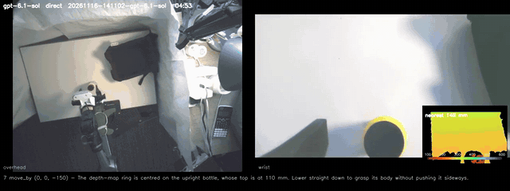
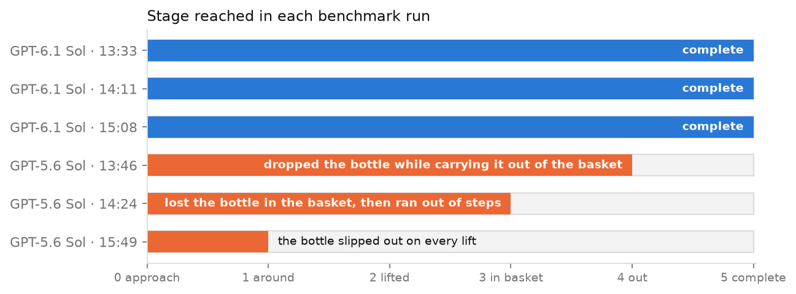
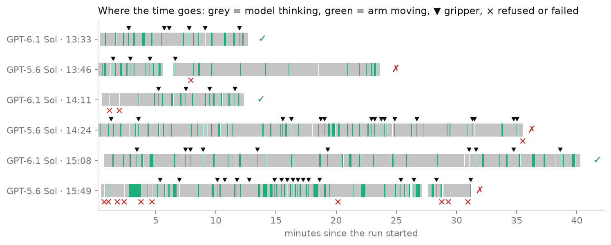
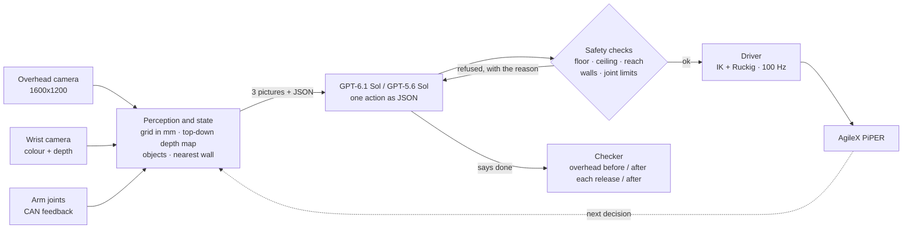
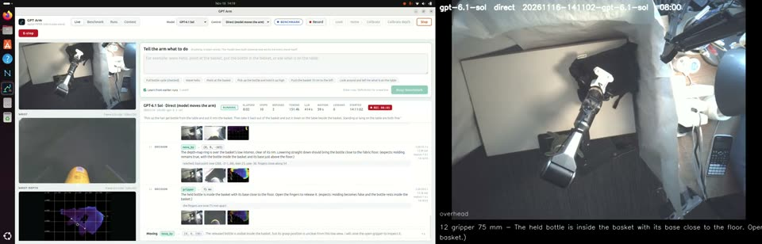

<div align="center">

# GPT Arm

**A language model drives a real robot arm from two cameras, choosing every move itself.**

AgileX PiPER · overhead camera + wrist depth camera · GPT-6.1 Sol and GPT-5.6 Sol · a portal, a benchmark and the full results

[](LICENSE)




<sub>GPT-6.1 Sol puts the bottle into the basket and takes it out again. Only the seconds the arm moved, at 3x; the model spent the rest thinking.</sub>

</div>

---

## Results at a glance

A six-run benchmark on one instruction: *pick the hair-gel bottle up from the table, put it into the basket,
take it back out and put it down beside the basket.* Every motion was the model's own choice.

| Model | Complete | Mean stage (0-5) | Decisions per run | Minutes per run | Tokens per run | s per decision |
|---|:-:|:-:|:-:|:-:|:-:|:-:|
| **GPT-6.1 Sol** | **3 / 3** | **5.00** | 21 | 13.1 | 396,661 | 30.8 |
| GPT-5.6 Sol | 0 / 3 | 2.67 | 60 (the budget) | 31.2 | 698,256 | 18.5 |

<sub>Medians except tokens (mean). Three runs per model, so read it as a strong hint, not a ranking: a 3-0 split has a two-sided Fisher exact p of 0.10. Stages: 1 around the bottle, 2 lifted, 3 in the basket, 4 out of the basket, 5 put down on the table.</sub>

<p align="center"></p>

- **The arm stood still 85% of the time.** The model was thinking for 8,071 of the 9,484 benchmark seconds.
  The median decision took 20.7 s across all 416 decisions; a move takes 2 to 9 s.
- **GPT-5.6 Sol lost the bottle three different ways:** dropped it while carrying it out of the basket,
  closed on the basket's fabric, and lifted six times while the bottle stayed on the table.
  GPT-6.1 Sol made a similar mistake once and corrected it.
- **The work that made it succeed was perception.** The first success came after eight failed runs,
  once the wrist depth camera's view was rebuilt as a top-down height map that remembers what scrolled out of view.

<p align="center"></p>

All 19 runs, their logs, the per-decision table and the charts are in [`results/`](results/). The
interactive report (figures, a portal replay of every run, the videos) is the page in [`site/`](site/):
`python -m http.server -d site` and open `http://localhost:8000` (build its videos first with
`site/build_media.py`).

## How a decision works



For every decision the model receives:

1. the **overhead picture** with a millimetre grid in the arm's frame;
2. the **wrist picture** (what things are);
3. a **top-down height map** from the wrist depth camera: points moved into the arm's frame, 2 mm cells over
   ±160 mm around the tool point, every object 18 mm above the local floor listed with its size and long
   axis. Earlier frames stay, drawn dimmer, until the gripper opens or closes, because the depth camera sits
   behind the gripper and loses what is right under it;
4. the **state** as JSON: joints, tool point, lean, yaw, the direction the fingers close along, gripper width,
   holding, the nearest wall and its clearance, steps left.

It answers with one action: `move_tool` (x, y, z, lean, yaw, finger direction), `move_by`, `move_joints`,
`gripper`, a fresh `look`, or `done`. It writes a short plan first. A refused move costs a decision and the
model is told why.

## Two modes

| Mode | What the model decides | What the code does |
|---|---|---|
| **direct** (default) | the motion itself: a tool point (x, y, z mm, lean, yaw, finger direction), six joint angles, or a gripper width, one at a time | checks it (joint ranges, fingertips above the table on the whole path, reach, walls), moves it, reports what happened |
| **skills** (AgileX style) | which named skill comes next (`move_above(bottle)`, `lower`, `close_gripper`, `lift`, `stand_up`, ...) | carries the skill out; a governor refuses a skill whose preconditions do not hold and says why |

Skills mode reproduces AgileX's GPT-6 Astra demonstration
([piper-astra-jev](https://github.com/RobotKitAI/piper-astra-jev),
[blog](https://global.agilex.ai/blogs/robotics/how-to-control-robotic-arm-with-gpt-6-astra-and-jev-llm-model))
on different hardware. Direct mode is the experiment: nothing between the model and the motion but checks.

## Hardware

| | |
|---|---|
| Arm | AgileX PiPER (6 joints, two-finger gripper 0-75 mm) on a USB-CAN adapter (`can0`), at the middle of the long side of a white table about 100 x 60 cm |
| Wrist camera | Orbbec Dabai DC1 on the gripper: colour through UVC, depth (320 x 200, 10 fps) through OpenNI2 with Orbbec's driver (`install.sh` fetches it from Orbbec's ROS 2 package; it needs Orbbec's udev rule) |
| Overhead camera | any camera about a metre above the table that can serve JPEGs; here a Surface Pro 9 running Ubuntu, whose rear camera needs libcamera (`overhead/overhead_cam.py`) |
| Robot host | Ubuntu 24.04, no GPU (the model runs remotely; perception is plain OpenCV and NumPy) |

## Quick start

On the robot host, with the PiPER driver running (`driver/README.md`; it listens on 127.0.0.1:8770):

```sh
git clone https://github.com/izhangfly/piper-gpt-arm ~/gpt-arm && cd ~/gpt-arm
./install.sh --python /path/to/python   # a Python with numpy and opencv-python; the driver's venv works
```

<details>
<summary><b>Overhead camera (Surface Pro 9 or any JPEG camera)</b></summary>

On the camera machine, as root:

```sh
install -Dm755 overhead/overhead_cam.py /opt/gptarm/overhead_cam.py
install -Dm644 overhead/gptarm-overhead-cam.service /etc/systemd/system/
systemctl enable --now gptarm-overhead-cam
```

and on the robot host, a tunnel to it (it only listens on loopback): put the camera machine's address in
`~/.config/nervus/overhead.host` (or its Syncthing device ID in `overhead.device`, and `overhead-proxy`
finds it as it moves between networks), add a `Host overhead` entry to `~/.ssh/config` with
`ProxyCommand ~/.local/bin/overhead-proxy %p`, and run
`ssh -N -L 127.0.0.1:8798:127.0.0.1:8798 overhead` as a user service.
</details>

<details>
<summary><b>The model</b></summary>

Install the Codex CLI (`npm install -g @openai/codex`). Put your AgentRouter key in
`~/.config/nervus/openai.key` (mode 600), and this in `~/.config/nervus/codex/config.toml`:

```toml
model_provider = "AgentRouter"
[model_providers.AgentRouter]
name = "AgentRouter"
base_url = "https://agentrouter.org/v1"
env_key = "CODEX_GATEWAY_API_KEY"
wire_api = "responses"
```

AgentRouter only serves its supported clients, which is why the calls go through Codex rather than plain
HTTP. Check the route: `python -m gptarm.llm gpt-5.6-sol`.
</details>

Then:

1. **Calibrate** once, and again whenever the overhead camera moves: the portal's Calibrate button or
   `python -m gptarm.calib` (the arm visits about 40 points; about 10 minutes). `--repose` re-fits only the
   camera's position after a nudge, keeping the lens model. **Calibrate depth** once with the bottle standing
   on the table. **Measure the walls** behind the table with `python -m gptarm.depth wall`.
2. Open **GPT Arm** on the desktop, choose a model and a mode, type an instruction (or keep the default
   task), press Run. STOP holds the arm; E-STOP is the driver's emergency stop.
3. **Benchmark**: choose models, runs per model and whether runs may learn from each other (off by default).
   Runs alternate between models and the benchmark pauses when the scene needs a hand.
4. **Results**: `python tools/export_results.py ~/gptarm-runs --out results` and `python tools/make_charts.py`.

Without the arm: `python -m gptarm.server --sim` serves the portal on a simulator.

<p align="center"></p>

## Safety

The driver and the service listen on loopback only: they move the arm and have no login. Moves run at 20%
of the arm's speed. A move is refused before it starts if a joint would leave its range, a fingertip would
go below the floor anywhere along the path (20 mm in skills mode, 8 mm in direct mode; the table is 0), the
wrist would rise into the overhead camera (560 mm), the point is out of reach, or any part of the arm would
come within 15 mm of a measured wall. The camera, wrist, gripper and fingertips are modelled as spheres for
that, and checked again while the move runs. During a move the driver stops the arm if a joint lags its plan
or the IK would flip, and while the arm holds still it nudges a motor that starts hunting (`driver/README.md`).
Keep a hand near the physical e-stop anyway: a model can choose a bad motion, and perception can be wrong.

## Repository layout

```
gptarm/            the service: arm, perception, depth, calibration, direct and skills modes, runner, checker, portal
  arm.py           tool point, lean, finger direction, walls, floor and ceiling checks, blocking moves
  depth.py         wrist depth: mount, top-down height map, objects, memory, wall measurement
  direct.py        what the model is told, the answer's JSON schema, the checks and the executor
  runner.py        one run (recorded step by step) and a benchmark; the checker's pictures after each release
  judge.py         the checker: success / fail / impossible with a critique
  calib.py         overhead calibration with the arm as the target; --repose after a nudge
  perception.py    the bottle and the basket from the overhead camera
  task.py          skills mode and the bookkeeping both modes share
  lessons.py       notes the model writes after a run and reads before the next (off in benchmarks)
  llm.py           the model client (Codex CLI, one session per decision, strict JSON)
  server.py, web/  the portal and its API (API.md)
  sim.py           a pretend arm, table and cameras for tests and for trying the portal
results/           all runs: raw logs, runs.csv, decisions.csv, the buzz analysis, charts (results/README.md)
site/              the report page: index.html, assets, data, build_media.py, deploy.sh
tools/             export_results.py, make_charts.py, buzz.py, record_runs.py, screencast.py, make_report.py,
                   drive.py, look.py, peek.py, calib_probe.py, depth_check.py, mock_server.py
overhead/          the overhead camera server for a Surface Pro 9 and overhead-proxy
desktop/           the portal as a desktop app (GTK + WebKit) and the service's systemd user unit
driver/            the PiPER driver this runs on (in NervusOS-Cambridge it is hardware/piper)
tests/             unit tests (simulated arm and cameras; no hardware needed)
docs/              BACKGROUND.md, REPORT-TEMPLATE.md, portal screenshots, README images
```

## Tools for looking at runs

| Tool | What it does |
|---|---|
| `tools/export_results.py` | turns a runs folder into `results/` (raw logs, CSVs, summary) and the report page's data |
| `tools/make_charts.py` | static charts of the results (SVG and PNG) |
| `tools/record_runs.py` | screen-records the portal for every run and converts it to MP4 (GNOME on Wayland) |
| `tools/screencast.py` | one screen recording through GNOME Shell's own recorder, over SSH |
| `tools/buzz.py` | finds motor hunting: microphone recording plus the motors' CAN feedback, ranked per hold |
| `tools/make_report.py` | the benchmark report as Markdown with Wilson intervals |

## Tests

```sh
python -m unittest discover -s tests          # 79 tests, no hardware
python -m unittest discover -s driver -p "test_*.py"
```

## Credits

Author: **Ian Zhang** ([@izhangfly](https://github.com/izhangfly)).

Borrowed and adapted: the lessons mechanism from [ExpeL](https://github.com/LeapLabTHU/ExpeL) (Apache-2.0);
the checker's prompt from [PragmaBot](https://github.com/leggedrobotics/pragmabot)'s success detector
(BSD-3-Clause), with three outcomes as in [Agent Workflow Memory](https://github.com/zorazrw/agent-workflow-memory)
and a critique loop as in [Voyager](https://github.com/MineDojo/Voyager) (MIT); the OpenNI2 runtime and
Orbbec driver from [ros2_astra_camera](https://github.com/orbbec/ros2_astra_camera) (Apache-2.0), read with
the [openni](https://pypi.org/project/openni/) bindings (MIT).

The skills-mode design (the model picks a named skill, a governor checks preconditions, a grasp counts when
the fingers stop part way, strict JSON answers, the lean about the finger line) is adapted from
[RobotKitAI/piper-astra-jev](https://github.com/RobotKitAI/piper-astra-jev) (Apache-2.0). The PiPER
driver builds on [AgileX piper_sdk](https://github.com/agilexrobotics/piper_sdk) and
[Ruckig](https://github.com/pantor/ruckig). Models are reached through the
[Codex CLI](https://github.com/openai/codex) and AgentRouter. The report page uses the Geist, Geist Mono and
Newsreader typefaces (SIL Open Font License).

## Citation

```bibtex
@misc{zhang2026gptarm,
  author = {Ian Zhang},
  title  = {GPT Arm: language models driving an AgileX PiPER arm from two cameras},
  year   = {2026},
  url    = {https://github.com/izhangfly/piper-gpt-arm}
}
```

## Licence

Apache-2.0 (see [`LICENSE`](LICENSE)).
