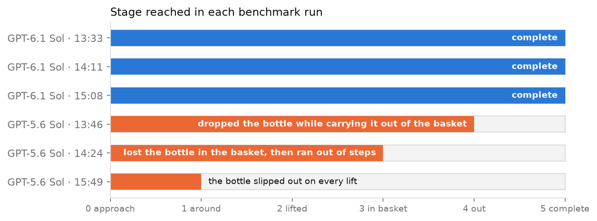
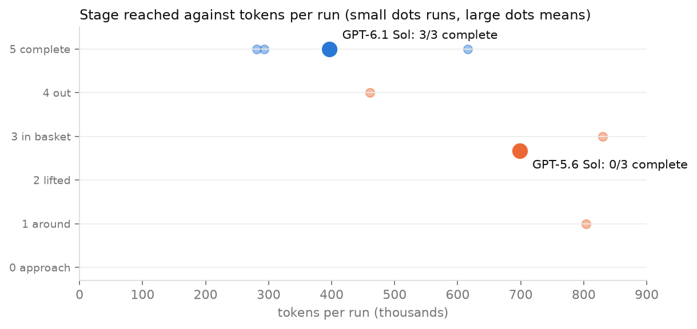
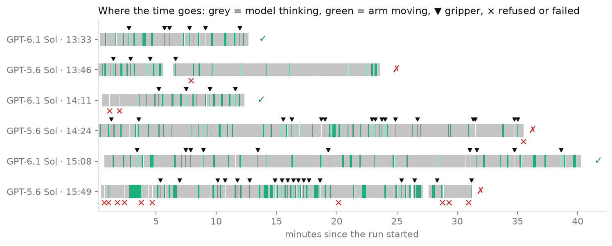
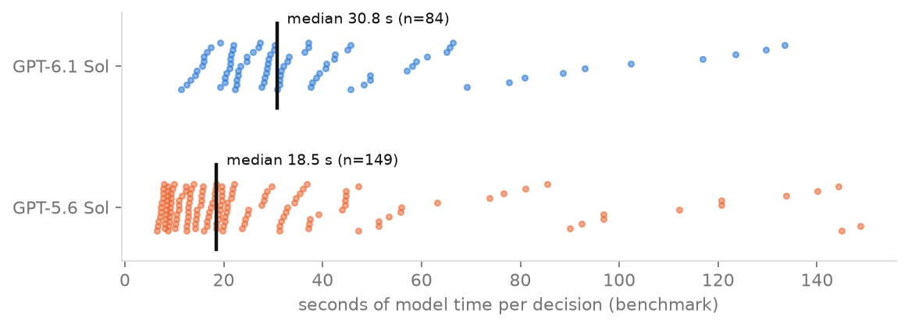
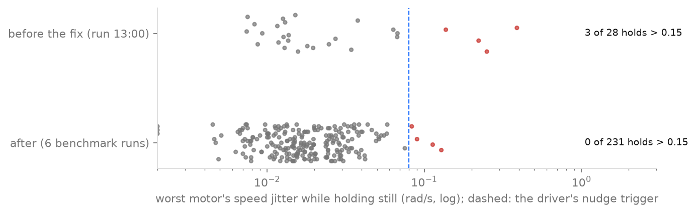

# Results: 15-16 November 2026

Every run of GPT Arm on the rig, as recorded, and the tables and charts made from them. The report page
(`../site/`) draws every figure from these same files.

```
results/
  raw/<run id>/run.json        each run's own log, exactly as the runner wrote it (19 runs)
  raw/bench-<id>.json          the benchmark's own record (which runs, in which order, its summary)
  runs.csv                     one row per run
  decisions.csv                one row per model decision (416)
  summary.json                 per-model benchmark figures and totals over all runs
  annotations.json             judgements a log can't hold: the stage each run reached, what ended it
  holds.csv, hunts.csv         the motor-buzz analysis (see below)
  charts/*.svg, *.png          static charts (tools/make_charts.py)
```

Rebuild the tables from a runs folder (the robot host keeps them in `~/gptarm-runs`):

```sh
python tools/export_results.py ~/gptarm-runs --out results --site site/data/report.json
python tools/make_charts.py --results results          # needs matplotlib
```

## The benchmark

`bench-20261116-133321`, 16 November 13:33-16:20. Instruction: *"Pick up the hair gel bottle from the table
and put it into the basket. Then take it back out of the basket and put it down on the table beside the
basket. Standing or lying on the table are both fine."* Direct mode, models alternating, no notes carried
between runs. It was set up for five runs per model and stopped after three each: an arm error in its
start-of-run check ended it instead of pausing it (fixed in `gptarm/runner.py` the same evening).

| Model | Complete | Mean stage | Decisions (median) | Minutes (median / mean) | Tokens per run (mean) | s per decision (median) | Refused or failed |
|---|---|---|---|---|---|---|---|
| GPT-6.1 Sol | 3 / 3 | 5.00 | 21 | 13.1 / 22.4 | 396,661 | 30.8 | 2 of 84 |
| GPT-5.6 Sol | 0 / 3 | 2.67 | 60 | 31.2 / 30.3 | 698,256 | 18.5 | 12 of 149 |

## Stages

Each run of the full-cycle task is scored by the highest stage it reached, assigned from the log (the
gripper's `holding` flag and the width at which the fingers stopped) and the step pictures, not from the
model's own account. A drop doesn't count as reaching the next stage.

| Stage | Meaning |
|---|---|
| 0 | No purposeful approach to the bottle |
| 1 | Gripper around the bottle on the table, no secure grasp |
| 2 | Bottle grasped and lifted clear of the table |
| 3 | Bottle released inside the basket, gripper withdrawn |
| 4 | Bottle grasped again inside the basket and lifted clear of the rim |
| 5 | Bottle put down on the table outside the basket and released under control |

## runs.csv

| Column | Meaning |
|---|---|
| `run_id` | `YYYYMMDD-HHMMSS-<model>`, the start time (UTC, which is local time in November in the UK) |
| `model`, `mode` | the model id (`scripted` = no model) and the control mode (`direct`: the model gives every motion; `skills`: it picks named skills) |
| `task` | `full_cycle`, `out_of_basket`, `cycle_upright`, `stand_up`, `wave` or `other`, from the instruction |
| `benchmark`, `benchmark_index` | the benchmark the run belongs to, and its place in it |
| `state`, `success`, `reason` | how the run ended (`done`, `failed`, `stopped` by hand), whether it succeeded, the runner's reason (`step_limit`, `arm_fault`, a checker failure kind...) |
| `duration_s` | wall-clock seconds from start to end |
| `decisions`, `moves`, `gripper_actions`, `refused_or_failed` | model decisions; how many were moves and gripper actions; how many the arm refused or failed to carry out |
| `model_calls`, `tokens` | calls to the model (decisions, the plan, the checker) and their input plus output tokens |
| `thinking_s`, `moving_s` | seconds spent in model calls and in arm motion |
| `checker`, `checker_confidence` | the checker's verdict and confidence, when it was asked |
| `lessons_used` | notes from earlier runs given to the model (0 in the benchmark) |
| `stage`, `failure_mode`, `cause` | from `annotations.json`: the stage reached, what ended the run, and whose side the cause was on (`model`, `perception`, `pipeline`, `hardware`, `operator`, `none`) |

## decisions.csv

One row per decision: `run_id`, `model`, `n` (the step number in the run's log), `action` and `target`, `ok`,
`t_end_s` (seconds from the run's start when its motion ended), `think_s` and `motion_s` (the model call's
duration and the motion's), `tokens`, `tool_x_mm`, `tool_y_mm`, `tool_z_mm` (the tool point after the
decision), `holding`, `gripper_mm` and `result` (what the arm reported).

## The buzz: holds.csv and hunts.csv

The arm made a loud buzz at some holds while nothing moved. `holds.csv` has one row per still period between
two moves, from the laptop's microphone (`band_150_400hz_db`: sound level in 150-400 Hz, median over the hold)
and the motors' own CAN feedback (`jN_motor_speed_std`: the standard deviation of each motor's speed over the
hold, rad/s; quiet holds are under 0.03). `fixed` is 0 for the run before the driver's hunting watch
(`20261116-130056`) and 1 for the six benchmark runs after it; `nudges` counts the watch's target nudges
during the hold. `hunts.csv` lists every nudge the driver made: time, joint, the motor's jitter, the nudge and
the new target. Made with `tools/buzz.py`; the fix is described in `driver/README.md` ("Hunting").

## Charts

| | |
|---|---|
|  |  |
|  |  |
|  | |
