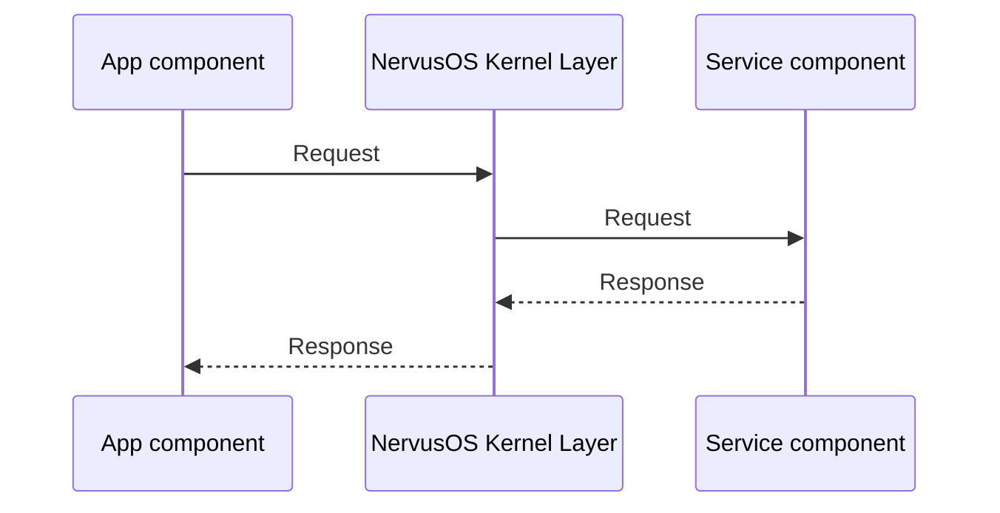
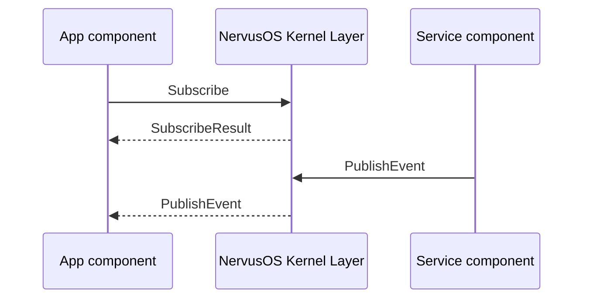

# NervusOS System Architecture Document

## 0. System Overview

NervusOS is a Linux distribution that defines Linux in user space, used for robot operating systems.

NervusOS supports various types of robots, as well as different models of the same type. The supported types include but are not limited to:

- Humanoid robots

- Wheeled robots

- Robotics dogs

- Mechanical arms

It controls different types of robots through specific interfaces. For different models of the same type, there should be functionally consistent interfaces; for specific fine-tuning, there are also specific interfaces for different models.

The hardware form of NervusOS should be various forms, and it can connect one or more robot entities via wireless network or wired connection, or can be directly loaded onto the robot body.

## 1. System Architecture

NervusOS adopts a layered architecture design, from top to bottom as follows:

- Application Layer (Application Layer)

- System Service Layer (System Service Layer)

- NervusOS Kernel Layer (Kernel Layer)

- Linux Kernel Layer (Linux Kernel Layer)

### 1.1 Layer Explanation

#### 1.1.1 Application Layer

The application layer is the part users directly interact with. It includes graphical user interface and user-level components. System desktop, system software, and applications developed by community developers all belong to the application layer.

#### 1.1.2 System Service Layer

The system service layer is the underlying and core implementation of NervusOS functions, including:

- Software Service (Software Service)

- Hardware Service (Hardware Service)

Software service refers to the implementation of software functions related to the NervusOS system, such as package installer, package manager, etc.; hardware service refers to the implementation of functions related to robot hardware, such as motor control, sensor data reading, etc.

Hardware service varies according to specific hardware conditions and plays a driver role in NervusOS.

#### 1.1.3 NervusOS Kernel Layer

The NervusOS kernel layer is responsible for managing component operation, communication, etc.

All processes corresponding to components are generated and managed by the NervusOS kernel layer. Only NervusOS can run components. The NervusOS kernel layer is also responsible for reclaiming component processes.

Components communicate through Unix Domain Sockets managed by the NervusOS kernel layer. This layer will record communication information, review permissions, etc. Components cannot communicate directly.

Unix Domain Sockets managed by NervusOS provide some kernel operation interfaces for components to perform system-level operations.

The NervusOS kernel layer includes the following processes (programs):

- init

- nervud

- displayd

#### 1.1.4 Linux Kernel Layer

This project does not plan to modify the Linux kernel, therefore this layer remains consistent with the Linux kernel.

### 1.2 Component Overview

The specific implementation of the layers above the NervusOS kernel is achieved by `components`, and the NervusOS kernel is responsible for managing the operation and communication of components.

According to the permission level of components, components are divided into:

- System Component

- User Component

System components can declare system-level permissions, and generally the kernel provides the declared permissions without user consent; user components can only declare user-level permissions.

System components are used for the system part of the system service layer and application layer, while user components are responsible for the implementation of user software UI and execution logic.

Components include:

- Service

- Application

Service is the specific implementer of functionality and the executor of control flow; application is merely a presenter of UI, its code purpose is only to define UI content and interaction logic, and its execution capability is achieved by calling specific services.

## 2. System Boot

After the computer (robot) is powered on, the system boot process is as follows:

1. Linux kernel loads and initializes hardware devices;

2. Linux kernel starts the init process;

3. The init process starts (Linux system-level) log manager, etc.;

4. The init process starts the nervud process;

5. The nervud process traverses the component list, loads components for boot-up;

6. The init process runs the nervud process as a daemon.

Among them, init and nervud are written by NervusOS developers, the graphics server uses Xorg, and the window manager uses Openbox.

### 2.1 init

init needs to implement sequentially:

1. Start auditd;

2. Start displayd;

3. Start nervud;

4. Run nervud process as a daemon.

init must properly handle zombie processes and orphan processes.

The init program is developed in C.

### 2.2 nervud

nervud needs to implement:

1. Create and manage Unix Domain Socket communication interface, must check if the sending UID has permission;

2. Component operation, management, etc;

3. Management of its own child processes.

The .sock file of Unix Domain Socket is defined under `/run/nervus/nervud.sock`, its permission is 0666, all users can read and write. Owner is root.

nervud process runs as user root, however, when running components, must switch to the assigned running user via setuid system call. It is strictly prohibited for nervud to run components as root.

nervud program is developed in Go language.

### 2.3 Display System Overview

The system is divided into two display strategies:

1. Native Display: Directly display to screen;

2. Remote Display: Transmit through network to remote device for display.

At the same time, only one display focus is allowed. For remote display strategy, only one device is allowed to connect. However, switching between the two display strategies does not require system restart. Local display strategy is defined by configuration file, if the configuration file does not define output to video output interfaces such as HDMI, then display focus is only remote display.

No component may directly operate display device; only App component can define UI content, render display managed by displayd.

App component is implemented by JavaScript scripting language, its code content is pre-compiled min.js file. The display program implemented by NervusOS kernel layer interprets and executes in sandbox, and renders UI definition etc.

Due to the special nature of robot environment, lightweight remote display is essential, therefore the following architecture design is made.

The specific implementation of display is detailed in chapter 5.

#### 2.3.0 Display Process

##### 2.3.0.1 displayd

displayd is the display service process managed by the NervusOS kernel layer, which is responsible for managing display devices, rendering UI content, etc. The displayd process runs as the user root. The displayd program is developed in Go.

The displayd process listens to the Unix Domain Socket interface at `/run/nervus/displayd.sock`, which has permissions only allowing root and the display group to read and write. The display process sends display rendering information (such as drawing lines, placing controls, etc.) to this interface and receives input events from components (such as clicks, swipes, etc.).

For native display strategies, the displayd process renders the received rendering information via Xorg and Openbox; for remote display strategies, the displayd process writes the received rendering information to the corresponding network API interface, and the remote device accesses the rendering information and renders it itself.

For devices with a display, displayd should start Xorg and Openbox at boot. For devices without a display, displayd should disable the native display device.

##### 2.3.0.2 display

display is the display interpreter process managed by the NervusOS kernel layer, which is responsible for interpreting and executing the UI definitions of App components, and sending rendering information to displayd.

Since it needs to use the V8 engine to interpret and execute JavaScript code, it is developed in Go.

display needs to run under an independent, non-privileged UID allocated by the App component, and join the display group.

#### 2.3.1 Native Display

Under the native display strategy, the UI content of components is rendered to the screen by the display program via displayd. Each software's window covers the previous software's window, meaning that the software started later will cover the UI of the software started earlier.

All software windows are full-screen and cannot be moved or resized.

#### 2.3.2 Remote Display

##### 2.3.2.1 displayd Behavior

Under the remote display strategy, the UI content of components is rendered to the network API interface via the display program. Remote devices access this interface to obtain rendering information and render it themselves.

displayd should maintain a virtual window stack on its own, saving the UI state of each App (hidden or displayed), and restore its state when switching (such as when the back key is pressed). This window stack should release the UI state of apps that have been closed.

In the network API interface, remote devices can only access the content of the top window of the stack.

##### 2.3.2.2 Remote Protocol

Under the remote display strategy, remote devices connect to the displayd process via WebSocket. Remote devices send control commands via WebSocket and receive rendering information.

## 3. Components

### 3.0 Package Definition

Components of NervusOS are distributed via packages, with the package format being `.nspkg`, which is essentially a tar compressed package, with the directory structure being:

```plain
com.example.app-1.0.0.nspkg/
├── manifest.json
├── manifest.sig
├── Other custom files...
```

#### 3.0.1 manifest.json

The manifest.json is a metadata file for the component, which includes information such as component definition, hash values of custom files within the package, etc. The component package must have a package.

Its structure is as follows:

```json
{
    "package": "com.example.app",  // Package ID
    "min_nervus_api": 1, // Minimum NervusOS API version
    "version": "1.0.0",  // Version number
    "version_code": 1,  // Version code
    "components": [
        {
            "type": "app", // Type
            "id": "com.example.app.main",  // Component ID
            "entry": "app/main.min.js",  // Entry file
            "launch_mode": "manual",  // Launch mode
            "runtime": "v8"  // Runtime environment
        },
        {
            "type": "service",
            "id": "com.example.app.service",
            "entry": "service/myservice",
            "launch_mode": "auto",
            "runtime": "native", 
            "permission_additions": [] // Custom permission list
        }
    ],
    "permissions": [
        "nervus.perm.camera",
        "nervus.perm.bluetooth"
    ], // Permission list
    "digests": {
        "app/main.min.js": "sha256:...",
        "service/myservice": "sha256:..."
    }  // File hash value
}
```

Field explanations are as follows:

##### 3.0.1.1 package

Package ID, format as `com.example.app`, that is, reverse domain format. Package ID is the unique identifier for a package.

When installing, if the package ID conflicts with an already installed package, and the version number is less than that of the already installed package, installation is rejected; otherwise, it is installed over the existing one.

Package ID is fixed as three segments (xxx.xxx.xxx), and cannot be in other formats

##### 3.0.1.2 min_nervus_api

Minimum NervusOS API version for compatibility check. If the current system API version is lower than this value, installation is rejected.

##### 3.0.1.3 version

Version number, format as `1.0.0`, that is, semantic version number.

##### 3.0.1.4 version_code

Version code, used to distinguish different versions of the package. When installing an existing package, if the version code is less than or equal to the already installed package, installation is rejected; otherwise, it is installed by overwriting.

##### 3.0.1.5 components

Component list, containing information about all components.

Each element in the component list is an object with the following fields:

- type: component type, can be `app` or `service`; note that a package can only have one `app` type component; for `service` components, there is no limit on the number, can be 1 or more.

- id: component ID, format is `com.example.app.main`, that is, reverse domain format; component ID equals package ID, or starts with package ID followed by `.` , it is considered as a component in the same package, otherwise it is considered as using a shared package.

- entry: component entry file path, relative to the package root directory; for app components, it is a JavaScript file; for service components, it is an executable file;

- launch_mode: launch mode, see section 3.4;

- runtime: runtime environment, can be `v8` or `native`; for app components, since JavaScript is used, it must be `v8`; for service components, it must be `native`.

##### 3.0.1.6 permissions

Permissions list, containing all the permissions required for this package. See Chapter 4.

##### 3.0.1.7 digests

File hash value, used to verify file integrity. key is the file path, value is the sha256 hash value.

##### 3.0.1.8 permission_additions

Only service components are meaningful. The list of new permissions added due to this service. See Chapter 4

#### 3.0.2 manifest.sig

manifest.sig is the signature file of manifest.json, whose content is mainly the signature of manifest.json.

It is also a JSON object, with the following structure:

```json
{
    "package": "com.example.app",
    "signatures": {
        "role": "developer",
        "alg": "ed25519",
        "key_id": "...",
        "key": "...",
        "sig": "..."
    }
}
```

##### 3.0.2.1 package

Package ID, consistent with the package field in manifest.json.

If this field does not match, installation is rejected.

##### 3.0.2.2 signatures

Signature information, containing the signer's identity, algorithm, public key, and signature value.

- role: the role of the signer, which can be `developer` or `platform`; among them, `developer` indicates a developer signature, and `platform` indicates a platform signature;

- alg: the signature algorithm, currently only ed25519 is supported;

- key_id: the public key ID;

- key: the content of the public key;

- sig: the signature value.

### 3.1 Component Types

Components are divided into two types:

- App (Application): responsible for UI display and interaction logic;

- Service (Service): responsible for the implementation of background functions.

#### 3.1.1 App

App components are the presenters of the user interface, whose code is used solely to define UI content and interaction logic. App components are implemented using the JavaScript scripting language, and their code content is a pre-compiled min.js file. The display program implemented by the NervusOS kernel layer is interpreted and executed within the sandbox of the V8 engine, and renders UI definitions and other elements.

The entry file of the App component is the file specified by the entry field in the manifest.json.

##### 3.1.1.0 Runtime

When starting the App component, the kernel will fork and exec the display program, passing the path to the App component's entry file as a parameter. The display program will load and execute this file upon startup.

Before starting display, the kernel will set the corresponding child process's UID to the UID independently allocated for the App component. Its GID is the display group. Therefore, the display program runs under a non-privileged user. This UID has the ability to communicate with displayd.

##### 3.1.1.1 Script Definition Functions

App component scripts must define the following functions:

```javascript
function onCreate(app, arg) {
    // Initialization logic
}
```

Optionally, the App component can also define the following functions:

```javascript
function onDestroy(app) {
    // When the program exits
    app.exit();  // Must be called
}

function onBackPress(app) {
    // When the user presses the back key
}

function onPause(app) {
    // When pressing the Home button
}

function onResume(app) {
    // When resuming from background to foreground
}
```

###### 3.1.1.1.1 onCreate

The onCreate function is called once when the App component starts. Its parameters are the App object and the startup parameters.

During this period, the App needs to draw the initial UI content and register event listeners.

The startup parameters are passed by the caller that starts the App component via the `executeComponent` method, and they are a string.

###### 3.1.1.1.2 onDestroy

The onDestroy function is called when the App component exits. Its parameter is the App object.

In this function, if necessary, the App needs to perform cleanup work and call the app.exit() method to exit the program.

However, even without calling the app.exit() function, display must force exit the program after this function times out.

###### 3.1.1.1.3 onBackPress

The onBackPress function is called when the user presses the back key. Its parameter is the App object.

When the back key is pressed, display needs to call this function. If the function is not defined or returns false, displayd will close the current App; otherwise, displayd executes its logic.

###### 3.1.1.1.4 onPause, onResume

The onPause function is called when the user presses the Home key. Its parameter is the App object.

The onResume function is called when the App component is resumed from the background to the foreground. Its parameter is the App object.

The logic related to the Home key is handled by displayd, and this function is only used to notify the App component. display also does not need to make any special handling.

##### 3.1.1.2 App Object

The App object is the context environment for the App component when it is running, and it contains the following properties and methods:

```javascript
class App {
    id: string;  // Component ID
    package: string;  // Package ID
    version: string;  // Version Number
    version_code: number;  // Version Code

    // Method
    // UI related
    addWidget(id, widget);
    updateWidget(id, properties);  // Update widget properties
    getWidget(id);  // Get widget
    getDpi(): number;  // Get screen DPI
    getWindowsSize(): { width: number, height: number };  // Get window size
    // Listener
    on(event, listener);
    // Service usage
    callService(serviceId, method, payload);
    // System interaction
    exit(); // Exit App
}
```

##### 3.1.1.3 Controls

The UI content of an App component is composed of controls. Controls are the basic units for displayd rendering.

The definition of a control is as follows:

```javascript
const widget = {
    type: "...",  // Control type
    x: 0,  // X coordinate
    y: 0,  // Y coordinate
    width: 100,  // Width
    height: 50,  // Height
    "text: "Button",  // Text content"
    font: {
        size: 16,
        color: "#000000"
        family: "Arial"
    }, interface_id
    backgroundColor: "#ffffff",  // Background color
    backgroundImage: "image.png",  // Background image (either background color or background image, relative path to the package)
    events: {  // Event listeners
        click: function(widget, event, app) {...}
    }
}
```

V8 provides the initWidget function, which directly returns the control:

```javascript
const w = initWidget(widget);
```

Among them, the widget parameter is the control definition object mentioned above, but the runtime part is omitted and the default value is used. Note that direct assignment to the control variable should be avoided, as this will break the reference relationship of the control. If you need to modify the properties of the control, you should use the `updateWidget(id, properties)` function.

###### 3.1.1.3.1 createWidget

The createWidget function is used to create a control in the display environment. Pass in id and the control object.

###### 3.1.1.3.2 updateWidget

The updateWidget function is used to update widget properties. Pass in id and a properties object.

Among them, the properties object can omit some fields, updating only the specified fields.

###### 3.1.1.3.3 Widget-level event listeners

Widget-level event listeners are defined in the widget's events field. The key is the event name, and the value is a callback function. The callback function's parameters are (widget, event, app).

###### 3.1.1.3.4 Widget types

Widget types include:

- text: text widget;

- button: button widget;

- image: image widget;

- input: input widget (single line);

- editText: edit widget (multi-line);

- canvas: canvas widget (Beta);

- webView: web widget;

###### 3.1.1.3.5 text

Text control is used to display text content. It has the common properties and events of the above control.

###### 3.1.1.3.6 button

button control is used for user interaction. It has the common properties and events of the above controls.

###### 3.1.1.3.7 image

The image control is used to display images. It has most of the general properties and events of the above control. But it does not have text, font, or other text-related properties, nor does it have the backgroundColor property.

###### 3.1.1.3.8 input

Input controls are used for single-line input. They have the general properties and events mentioned above.

The input content of input is updated in real time to the control object via display, so it can be directly obtained through `widget.text`. Changes to the input content require allowing callback.

###### 3.1.1.3.9 editText

The editText control is used for multi-line input. It has the common properties and events of the above control. The input content of editText is updated in real time to the control object by display, so it can be directly obtained through `widget.text`. Input content changes need to allow callback.

###### 3.1.1.3.10 canvas

canvas control is used for drawing graphics. It has the general properties and events of the above control.

canvas is currently in Beta version, specific API is omitted.

###### 3.1.1.3.11 webView

The webView control is used to load web pages. It has most of the common properties and events of the above control. However, it does not have text, font, and other text-related properties, nor does it have backgroundColor and backgroundImage properties.

It adds the following properties:

1. initUrl: string;  // Initial URL, optional
2. userAgent: string;  // User-Agent string, optional
3. initFile: string;  // Initial file path, relative to the package root directory, optional

It adds the following methods:

```javascript
webView.loadUrl(url);  // Load URL
webView.loadFile(file);  // Load file
webView.evaluateJavaScript(script);  // Execute JavaScript script
```

It adds the following event listeners:

1. onPageStarted: function(webView, event, app) {...}: Page starts loading;
2. onRedirect: function(webView, event, app) {...}: Page redirects;

Specifically, for the above events, the event object has some new fields:

For onPageStarted:

1. event.url: string;  // Page URL

For onRedirect:

1. event.url: string;  // Page URL
2. event.redirectUrl: string;  // Redirect URL

##### 3.1.1.4 Events

The App component supports the following events:

- EVENT.DISPLAY_FOCUS_CHANGED: Display focus changed (for example, native display converted to remote display);

Other events are omitted.

##### 3.1.1.5 Service Calls

See section 3.1.2.

##### 3.1.1.6 System Applications

System applications refer to applications with system permissions that are developed to implement system functions, such as desktop, settings, etc.

The runtime of system applications is the same as that of ordinary App components, but they have system permissions.

##### 3.1.1.7 User Applications

User applications refer to applications developed by ordinary users that do not have system permissions. Their runtime is the same as that of ordinary App components.

User applications can be freely installed by users.

#### 3.1.2 Service

Service component is the implementer of background functions, its code is used to implement background logic. Service component is a cross-compiled binary program. It is executed by the NervusOS kernel layer in the native runtime environment.

The entry file of Service component is the file specified by the entry field in manifest.json.

##### 3.1.2.1 Runtime

Each Service component will register a unique, auto-incrementing UID in a lookup table maintained by the kernel, stored on the hard disk. This UID will have a specific directory for storing service data, cache, etc; this directory is not readable, writable, or accessible by other users. This directory will also be entered into the lookup table.

This directory is created by the kernel, with the path of `/var/lib/nervus/service/<uid>`. Among them, uid corresponds to the service's UID.

In addition, for system services, a system service group will be created. This group has a shared directory for system services, with the path of `/var/lib/nervus/service/system`. Among them, group is the service group ID. The owner of this directory is root, created by the kernel. It is not readable, writable, or accessible by other users.

When starting a Service component, the kernel performs the following operations:

1. fork a child process;

2. setuid to the service's UID;

3. if it is a system service, setgid to the system service group's GID;

4. set affiliated groups according to permissions;

5. call exec to execute the entry file.

At the same time, the kernel will manage this process and clean it up when the process exits.

##### 3.1.2.2 Control Flow of Service

Service is the executor of control flow, and can perform the following functional operations:

1. call the service's provided interface;

2. subscribe to the service's events.

This represents two directions of control flow, that is:

1. passively accept requests from other components;

2. actively send events to other components.

##### 3.1.2.3 Kernel Forward Communication

Components communicate through Unix Domain Socket managed by the NervusOS kernel layer. The communication protocol format is defined by the nervus-ipc protocol. Control plane communication is based on stream sockets, with the socket path of `/run/nervus/nervud.sock`. Messages are transmitted in frame units, with each frame consisting of a 4-byte big-endian length field followed by a Protobuf-encoded message body. The length field indicates the number of bytes in the message body, excluding the length field itself.

###### 3.1.2.3.1 Message Envelope

Envelope is the only top-level message on the control plane, with one frame carrying exactly one Envelope. The body of Envelope is a oneof field, and the message category is distinguished by the field type. protocol_version is the protocol version number, with the value matching the NervusOS API version number.

```proto
message Envelope {
  uint32 protocol_version = 1;
  oneof body {
    // Call
    Request request = 30;
    Response response = 31;
    Cancel cancel = 32;

    // Subscribe and Events
    Subscribe subscribe = 40;
    SubscribeResult subscribe_result = 41;
    PublishEvent publish_event = 53;

    // Keep alive
    Ping ping = 60;
    Pong pong = 61;
  }
}
```

Message categories are grouped by functionality. Call occupies numbers 30 to 32, subscribe and event occupy numbers 40 to 41 and 53, keep alive occupies numbers 60 to 61. The kernel is only responsible for routing and forwarding to the target component, without parsing the content of the interface and method. After receiving a message, the kernel checks whether the protocol_version is supported. If not supported, it rejects the connection. The Request and Subscribe forwarded to the service component include the caller_permissions field. This field is left empty by the caller, and the kernel fills it in after reverse lookup of the component identity based on the peer UID of the Unix Domain Socket.

###### 3.1.2.3.2 Call

The caller initiates a call, carrying the request through Request and receiving the final result through Response. The kernel only routes and forwards to the target component, without performing any interface routing.

```proto
message Request {
  string request_id = 1;
  string target_service = 2;
  string method = 3;
  bytes payload = 4;
  repeated string caller_permissions = 5;
}

message Response {
  string request_id = 1;
  oneof outcome {
    Success success = 2;
    Failure failure = 3;
  }
}

message Cancel {
  string request_id = 1;
}
```

The Request carries the target component identifier, interface identifier, method ID, and serialized method request. The request ID is a UUID randomly generated by the requester, and each Request can have at most one final Response. target_service is the ID of the called service, and the kernel forwards the call to the corresponding service based on it. caller_permissions is the list of component permissions for the call, and this field must be empty in the Request sent by the caller, filled by the kernel when forwarding. Cancel is used to cancel an ongoing call, and the Response of the canceled request carries the CANCELLED result.

After the kernel receives the Request from the caller, it looks up the component identity through the remote UID of the Unix Domain Socket, fills the caller_permissions field with the custom permission list held by the calling component and declared by the target service through permission_additions, and forwards it to the target component. The target component can then clearly determine which custom permissions the calling component has declared and added. After the target component executes, it sends back the Response, and the kernel forwards the Response back to the caller as is.

###### 3.1.2.3.3 Subscription and Events

Subscription is a mechanism by which a Service provides events externally. A Service can declare events, and the event ID uses the reverse domain format `component ID.event.xxxx`. A Service pushes events to the kernel through PublishEvent, and the kernel forwards the events according to the visibility scope defined in PublishEvent.

```proto
message Subscribe {
  string request_id = 1;
  string event_id = 2;
  bytes payload = 3;
  repeated string caller_permissions = 4;
}

message SubscribeResult {
  string request_id = 1;
  oneof outcome {
    Success success = 2;
    Failure failure = 3;
  }
}

message PublishEvent {
  string event_id = 1;
  bytes payload = 2;
  EventVisibility visibility = 3;
}

enum EventVisibility {
  EVENT_VISIBILITY_UNSPECIFIED = 0;
  EVENT_VISIBILITY_PACKAGE = 1;
  EVENT_VISIBILITY_PUBLIC = 2;
}

message ListEventSubscribersRequest {
  string event_id = 1;
}

message EventSubscriber {
  string component_id = 1;
  string package_id = 2;
}

message ListEventSubscribersResponse {
  repeated EventSubscriber subscribers = 1;
}
```

Subscribe carries the event ID to subscribe to and subscription parameters, SubscribeResult indicates whether the subscription is successful. caller_permissions is a list of permissions of the calling component, the field must be empty in the Subscribe sent by the caller, and the kernel fills it with the custom permissions held by the calling component that belong to the target service through permission_additions declaration when forwarding, the target service can thus clearly determine which custom permissions the calling component has declared and added, and decide whether to accept the subscription, and if not met, can return PERMISSION_DENIED in SubscribeResult. PublishEvent is reported by Service, carrying event ID, event payload, and visibility scope, it is a one-way message with no result. EVENT_VISIBILITY_PACKAGE indicates that only components in the same package can receive the event, EVENT_VISIBILITY_PUBLIC indicates that all components that successfully subscribe to the event can receive the event, EVENT_VISIBILITY_UNSPECIFIED is an invalid value.

The kernel virtual service `nervud.system.server` provides the `listEventSubscribers` method, used to query the subscribers of a specified event, the returned result includes the subscriber component ID and PackageID.

###### 3.1.2.3.4 Keepalive

Ping and Pong are used to detect the liveness of the peer and measure round-trip latency, either side can initiate. nonce is selected by the initiator, and the responder echoes it back as is.

```proto
message Ping {
  uint64 nonce = 1;
}

message Pong {
  uint64 nonce = 1;
}
```

###### 3.1.2.3.5 General Result Semantics

All results use StatusCode classification. Success and Failure form the two branches of the result, and their code values have fixed constraints.

```proto
enum StatusCode {
  STATUS_CODE_UNSPECIFIED = 0;
  STATUS_CODE_OK = 1;
  STATUS_CODE_ACCEPTED = 2;
  STATUS_CODE_INVALID_ARGUMENT = 3;
  STATUS_CODE_UNAUTHENTICATED = 4;
  STATUS_CODE_PERMISSION_DENIED = 5;
  STATUS_CODE_NOT_FOUND = 6;
  STATUS_CODE_FAILED_PRECONDITION = 7;
  STATUS_CODE_RESOURCE_EXHAUSTED = 8;
  STATUS_CODE_DEADLINE_EXCEEDED = 9;
  STATUS_CODE_CANCELLED = 10;
  STATUS_CODE_UNAVAILABLE = 11;
  STATUS_CODE_INTERNAL = 12;
}

message Success {
  StatusCode code = 1;
  bytes payload = 2;
}

message Failure {
  StatusCode code = 1;
  string public_message = 2;
  bytes error_detail = 3;
}
```

Status code describes the category of failure rather than the specific cause. Success codes include OK and ACCEPTED, where OK indicates the call has completed, and ACCEPTED indicates the system has reliably received the create request but does not indicate final success. Failure codes include illegal parameters, invalid identity, unauthorized access, target not found, preconditions not met, quota exhausted, timeout exceeded, canceled, currently unavailable, and internal error categories. Success branch code can only be success codes, and Failure branch code can only be failure codes. The payload of Success is a method-specific response, whose type is determined by the interface and method. Failure carries only human-readable prompt information and an optional type-specific detailed cause, where the message type of the detailed cause is determined by the outer message.

###### 3.1.2.3.6 Message Flow

The message flow of a single call is as follows.



A message flow for a subscription and event push is as follows.



##### 3.1.2.4 Direct Communication

In order to place kernel forwarding large data, Service component supports direct communication. Service component can create Unix Domain Socket, for other components to connect one-to-one.

When creating Socket, Service component needs, according to the protocol of calling service, request the kernel maintained `nervud.system.server` virtual service's `allocSocket` method, to request allocation of a socket path. The request payload of this method is the component ID allowed to access, the response payload is a string type available socket path, Service component can use this path to create Unix Domain Socket. When Service component exits, the kernel will automatically clean up this socket.

When the kernel creates this sock file, the file owner is root, through ACL set permissions, only allowing Service calling `allocSocket` method, and the component allowed to access specified when calling method to access.

The communication protocol in this Socket is defined by Service component itself.

##### 3.1.2.5 Virtual Service

Virtual service is a special service provided by NervusOS kernel, its code does not run in user space, but runs in kernel space. Virtual service ID must be `nervud.system.server`. It means system internal reserved service, for other components needing to interact with kernel to call.

The internal implementation of virtual service is completely different from service in component, but its calling process is completely transparent to caller. Caller does not need to distinguish whether it is calling virtual service or normal service.

Kernel handles the method directly by intercepting the request data packets of `nervud.system.server`, without forwarding to any user space service.

List of virtual services see section 7.1.

##### 3.1.2.6 Basic System Services

Basic system services are services necessary for NervusOS system to run, they are usually automatically loaded and run by kernel at boot time. They are important guarantee for system integrity, for example package management service, etc.

List of basic system services see section 7.2.

##### 3.1.2.7 Pre-installed System Services

Pre-installed system services are optional for NervusOS system to run, but services pre-installed for better user experience. For example file management service, etc.

List of pre-installed system services see section 7.3.

### 3.2 Package Management

NervusOS package management system is implemented by system services, kernel does not provide related API. These system services will install components in package into kernel recognizable component directory, and register in component registry. At the same time, these system services will also maintain a package list, recording installed packages.

Package management service also needs to correctly handle package uninstallation, ensuring all related resources are cleaned up when uninstalling, especially component directory and component registry.

Package management should handle update logic according to version. When updating, only replace component code files, and prohibit modifying component's own data directory, etc.

#### 3.2.0 Component Registry

Component registry is a data structure maintained by NervusOS kernel, only kernel (root) can access, used to record all registered component information. It contains component ID, component type, component entry file path, component permissions, etc. Component registry is loaded by kernel at boot time.

In addition, in order to maintain component registry, kernel provides a series of virtual services. In addition, these virtual services should atomically synchronize modifications to kernel's memory, and write to disk. These virtual services see section 7.1.2.

The data structure of component registry is as follows:

```go
type Component struct {
  ID string `json:"id"`
  Type ComponentType `json:"type"`
  Entry string `json:"entry"`
  Permissions []ComponentPermission `json:"permissions"`
  WorkDir string `json:"work_dir"`
  DataDir string `json:"data_dir"`

  UID int32 `json:"uid"`

  Role string `json:"role"` // developer or platform

  PermissionAdditions []AddedPermission `json:"permission_additions"`

  PackageID string `json:"package_id"`

  IsAvailable‌ bool `json:"is_available"`
}

type ComponentType int
const (
  ComponentTypeApp ComponentType = iota
  ComponentTypeService
)

type ComponentPermission struct {
  ID string `json:"id"`
  IsConfirmed bool `json:"is_confirmed"` // Whether it is confirmed
}
```

Among them, PermissionAdditions is a new permission customized by the service, see chapter 4.

The Entry field is the component entry path, which is a relative path, relative to the working directory. WorkDir is the component working directory, DataDir is the component data directory. UID is the user ID of the component at runtime. Role is the component role, see section 3.0.2.2.

The working directory of the component is the directory where the component code is stored. This directory is read-only for the component.

UID is assigned by the package management service during installation, and is prohibited from being modified during upgrades. Group-related permissions are managed by the kernel according to the permissions.

PackageID is the ID of the component package being loaded.

IsAvailable indicates the availability of the component.

The component registry is a file, accessible only by the kernel (root), stored at `/run/nervus/components.json`. This JSON is a list. The kernel has permission to read and write.

#### 3.2.1 Code Directory

When installing the NervusOS software package, the package management service creates a directory under `/var/lib/nervus/packages`, with the directory name being the package ID, to store its code.

The package manager will decompress the package to a tmp temporary directory, check the file paths inside the compressed package to prevent path attacks in the compressed package. After passing the check, it will copy it to the corresponding directory, and then call the kernel's virtual service to register the component.

During updates, the corresponding component should first be set to unavailable, then overwrite the directory; if the new package removes some components, it should call the kernel's virtual service to delete the component; if new components are added, it should call the kernel's virtual service to register the component. Finally, ensure that components set to unavailable due to the update are reset to available.

The code directory created has read-only permissions for the UID of the component.

#### 3.2.2 Data Directory

For new components, the package manager not only creates the code directory, but also creates the data directory. The data directory is `/var/lib/nervus/package-data/<package_id>/`. The UID of the component has read and write permissions.

### 3.3 Execution

The kernel provides a virtual service `executeComponent` to run the component. This method accepts a component name and a start parameter string, and returns a success or failure value. If it fails, it will specify the reason for the failure.

For calls initiated by components from the same package, the kernel should directly pass through. Otherwise, it must declare the permission `nervus.system.perm.execute`, otherwise the kernel will reject the execution.

For components that have declared the start mode as `start_on_boot`, the kernel will automatically run them after loading; for components that have declared the start mode as `always_on`, the kernel will automatically run them after loading and automatically restart them after they exit. Other components need to be started by calling the virtual service `executeComponent`.

### 3.4 Start Mode

Components support the following start modes:

- `manual`: Manually started, not automatically started. Only App components support this;
- `auto`: Started when other components call it, for example, when calling a Service component, if the Service component is not running, the kernel will automatically start it. If it does not exit within the specified timeout period and there are no other calls, the kernel will automatically terminate its process. The configuration of the timeout period is described in chapter 6;
- `start_on_boot`: Automatically started when the system boots;
- `always_on`: Automatically started when the system boots, and automatically restarted after it exits.

Only components that have applied for one of the following two permissions can declare the start mode `start_on_boot`:

- `nervus.perm.start_on_boot`: Allows the component to be automatically started when the system boots, this permission must be confirmed by the user;
- `nervus.system.perm.start_on_boot`: Allows the component to be automatically started when the system boots, only for system components;

Only components that have applied for the following permissions can declare the start mode `always_on`:

- `nervus.perm.always_on`: Allows the component to be automatically restarted after exiting, this permission must be confirmed by the user;
- `nervus.system.perm.always_on`: Allows the component to be automatically restarted after exiting, only for system components;

### 3.5 Component Lifecycle

The lifecycle of the component is managed by the kernel. When the component starts, the kernel creates a process to run the component. When the component exits, the kernel will clean up the related resources.

For App components, the lifecycle is as follows:

1. Start: The kernel creates a process to run the component; corresponds to the `onCreate` method;
2. Running: The component runs in the process; at this time, it is still in the `onCreate` method;
3. Exit: The component exits, and the kernel cleans up the resources; corresponds to the `onDestroy` method;

In particular, there is also a paused state, corresponding to the `onPause` method and `onResume` method of the App component.

For the Service component, there is no pending state. Its startup corresponds to the `_start` symbol of the executable file. When the kernel forcibly terminates, it sends a SIGTERM signal to the process, which should properly handle the signal and exit. If the process does not exit within the time specified in the configuration, the kernel will send a SIGKILL signal to forcibly terminate it. Configuration details are described in Chapter 6.

## 4. Permissions

### 4.1 Permission Classification

From the perspective of the roles that can declare permissions, permissions are divided into system permissions and user permissions, corresponding to the `developer` and `platform` roles respectively. System permissions can only be applied for by system components, while user permissions can be applied for by any component. System permissions use the format `nervus.system.perm.xxxx`.

From the perspective of the source of permissions, permissions are divided into built-in permissions and custom permissions. Built-in permissions are permissions predefined by the NervusOS kernel, while custom permissions are permissions customized by services.

However, the source of all built-in permissions is the kernel virtual service, that is, `nervus.system.server`. The source of custom permissions is the service itself, that is, the `permission_additions` field declared when the service is registered. This field is a list, and each element is an `AddedPermission` structure.

From the perspective of permission control methods, they are divided into service-controlled permissions and group-controlled permissions. Service-controlled permissions are controlled by the service itself, while group-controlled permissions are controlled by user groups. Group-controlled permissions specify their belonging group through the `GID` field in the permission registry. Group-controlled permissions mainly control access to the file system, devices, etc.

All group-controlled permissions are built-in permissions. User groups are created and the corresponding file permissions are configured during the system's initial state.

Unlike Android, the system does not specially set network permissions.

### 4.2 Permission Registry

The permission registry is a data structure maintained by the NervusOS kernel, used to record all registered permission information. It includes information such as permission ID, permission type, and permission source. The permission registry is loaded by the kernel during startup.

Like the component registry, the permission registry is also a file, stored in `/run/nervus/permissions.json`. This JSON is a list. The kernel has permission to read and write.

Similarly, the kernel provides a virtual service for managing the permission registry, see Section 7.1.3.

The data structure of a permission is as follows:

```go
type Permission struct {
  ID string `json:"id"`
  Type PermissionType `json:"type"`
  Source string `json:"source"`

  GID int32 `json:"gid"` // Group ID that the permission belongs to

  NeedUserConfirm bool `json:"need_user_confirm"`

  Description string `json:"description"` // Description information for users to view
}

type PermissionType int
const (
  PermissionTypeSystem PermissionType = iota
  PermissionTypeUser
)
```

In addition, the `AddedPermission` struct is as follows:

```go
type AddedPermission struct {
  ID string `json:"id"`
  SystemPermission bool `json:"system_permission"`
  NeedUserConfirm bool `json:"need_user_confirm"`

  Description string `json:"description"` // Description information for users to view
}
```

Field explanations are as follows:

- `ID`: Permission ID, uniquely identifies a permission;
- `Type`: Permission type, system permission or user permission;
- `Source`: Permission source, if it is a built-in permission, it is `nervud.system.server`; if it is a custom permission, it is the service ID;
- `SystemPermission`: Whether it is a system permission;
- `NeedUserConfirm`: Whether user confirmation is required;
- `Description`: Permission description information;

### 4.3 Permission Application and Usage

When a component is registered, it can declare the permissions it requires.

For permissions that do not require user confirmation, the kernel automatically grants them if the role matches. For permissions that require user confirmation, the kernel sets them as unconfirmed in the component registration table. Components can call the `confirmPermission` method of the basic system service `nervus.service.permission` to confirm the permission. This method accepts a permission ID and returns a success or failure value. When this method is called, this system service will invoke a permission confirmation dialog box. After the user confirms, this method uses the system permission `nervus.system.perm.confirm_permission` to call the `confirmPermission` method of `nervud.system.server`, and the `nervud.system.server` virtual service, upon receiving the request, will modify the permission registration table, marking the permission as confirmed.

When the `nervus.service.permission` service calls the permission dialog box, it is actually implemented by invoking the permission dialog box App component. The ID of this App component is `nervus.app.permission_dialog`, and it is manually started by the system service.

For a component in a package declaring permissions successfully, the effect should be synchronized across all components in the package.

For a package, the package manager should register the permissions with the kernel during installation.

### 4.4 Permission Check

The kernel forwarding layer does not implement permission check logic, but delegates the permission check to the called service. After receiving the request, the service checks whether the caller has the corresponding permission. If the caller does not have the permission, the request is rejected.

For kernel virtual services, the permission check logic is also delegated to the implementation itself.

For user group controlled permissions, it is controlled using ACL with the GID of the permission.

In particular, for permissions related to auto-start, the kernel checks them during startup. If the check fails, App components automatically downgrade to `manual` mode; Service components automatically downgrade to `auto` mode.

### 4.5 Built-in Permission List

#### 4.5.1 User Group Controlled Permissions

| Permission ID | Description | Accessible Files/Directories | GID | Type | Need Confirmation |
| --- | --- | --- | --- | --- | --- |
| nervus.perm.bluetooth | Bluetooth access permission | /dev/rfcomm\* /dev/hci\* /sys/class/bluetooth/ /proc/bluetooth/ /var/lib/bluetooth/ /run/dbus/system_bus_socket | 20000 | User permission | Yes |
| nervus.perm.camera | Camera access permission | /dev/video* | 20001 | User permission | Yes |
| nervus.perm.datapath | Component shared data path access permission | /var/lib/nervus/data/ | 20002 | User permission | Yes |
| nervus.system.perm.file | Shared file system permission | / | 0 | System permission | No |
| nervus.perm.downloads | Shared download directory access permission | /var/lib/nervus/data/downloads/ | 20003 | User permission | No |
| nervus.perm.read_config | Read system configuration permission | /etc/nervus/config.yaml | 20004 | User permission | Yes |
| nervus.system.perm.read_config | Read system configuration permission (system component) | /etc/nervus/config.yaml | 20005 | System permission | No |

#### 4.5.2 Other Built-in Permissions

| Permission ID | Description | Type | Requires Confirmation |
| --- | --- | --- | --- |
| nervus.system.perm.execute | Component execution permission | System permission | No |
| nervus.perm.start_on_boot | System startup auto-start permission | User permission | Yes |
| nervus.system.perm.start_on_boot | System startup auto-start permission (system component) | System permission | No |
| nervus.perm.always_on | Auto-restart after exit permission | User permission | Yes |
| nervus.system.perm.always_on | Auto-restart after exit permission (system component) | System permission | No |
| nervus.system.perm.confirm_permission | Permission confirmation permission | System permission | No |
| nervus.system.perm.component_registry | Component registry access permission (via kernel virtual service) | System permission | No |
| nervus.system.perm.permission_registry | Permission registry access permission (via kernel virtual service) | System permission | No |

## 5. Display

Temporarily omitted.

## 6. Configuration

The NervusOS configuration file is provided by the kernel, and only the kernel and components that declare the `nervus.perm.read_config` or `nervus.system.perm.read_config` permission can read it. The configuration file is in yaml format and is stored at `/etc/nervus/config.yaml`. This file is loaded by the kernel at boot time.

The configuration file is a file representing the system's initial state, which can only be modified by the Root user. However, the kernel itself does not make modifications.

### 6.1 Configuration Items

Configuration items are as follows:

```yaml
system:
  timeout:
    component_stop: 10s # Time to wait for the component to exit after sending the SIGTERM signal
    component_auto: 10m # Maximum idle time for automatically started components
    app_ondestroy: 10s # Timeout time when the App component is destroyed
  display:
    default: headless/x11 # Default display strategy
```

Other configuration items will be added after future system version updates.

## 7. System Service List

To be omitted
